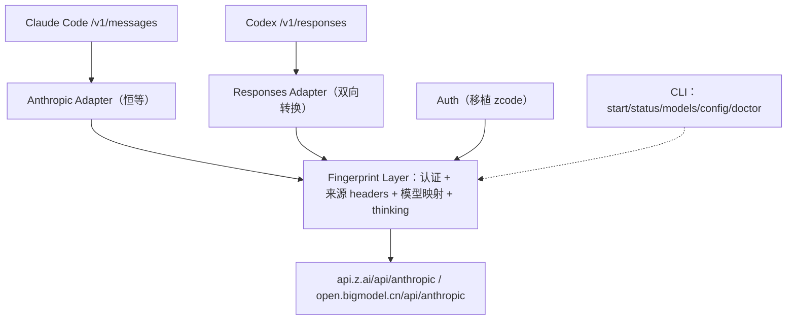

# zcode-proxy 设计文档

- 日期：2026-10-15
- 状态：待评审
- 作者：梁凯文

## 1. 背景与目标

个人订阅了 ZCode Coding Plan（ZCode 桌面端 / CLI 中的 Coding Plan 订阅），其后端模型为智谱 GLM（`GLM-5.3`、`GLM-5.3-Flash`）。希望在本地构建一个网关 **zcode-proxy**，把该订阅以标准 API 的形式暴露给第三方 AI 编程客户端使用：

- **Claude Code**（Anthropic Messages API，`/v1/messages`）
- **Codex**（OpenAI Responses API，`/v1/responses`）

### 核心目标

1. **被平台识别为 zcode 客户端发出的请求**：proxy 发往上游的请求必须完整复刻官方 zcode 客户端的认证链与请求指纹，使平台将其归类为 zcode Coding Plan 请求（走订阅额度、订阅排队/缓存规则），而不是通用 API 调用。
2. 本机个人使用，结构完整：CLI、模型发现、token 管理、双客户端支持，未来可打包。
3. 安全：仅绑定 loopback，不对外暴露。

### 非目标

- 不实现独立登录流程，复用 `~/.zcode` 已有登录数据；无登录态时引导用户先运行 `zcode login`。
- 不做账号体系、多用户、远程访问。
- 不实现上游不支持的能力（WebSearch、File Search、Code Interpreter、Computer Use、Artifacts）。

## 2. 可行性验证（已完成）

在本机使用真实登录态（实际登录为 **bigmodel family**）完成真机实测：

| 验证项 | 结果 |
|---|---|
| 认证链 | OAuth token → business JWT（仅 zai）→ 默认 org/project → project key → 短期 access token |
| 可用模型 | `GLM-5.3`、`GLM-5.3-Flash` |
| 非流式 | HTTP 200，标准 Anthropic 响应结构 |
| 流式 SSE | 完整事件序列：message_start / ping / content_block_start / content_block_delta / content_block_stop / message_delta / message_stop |
| Tool use | 返回 thinking + tool_use blocks，input 正确，stop_reason=tool_use |
| 认证 header | `Authorization: Bearer` 与 `x-api-key` 均 200 |
| 同一 token 对 paas/v4 | 200，但 paas/v4 为通用 API 端点，不用于本项目（见 §4） |

## 3. 上游 Endpoint

按登录 family 选择（zcode 内置配置）：

| family | Anthropic baseUrl |
|---|---|
| zai | `https://api.z.ai/api/anthropic` |
| bigmodel | `https://open.bigmodel.cn/api/anthropic` |

其他相关端点：

- 产品站：`https://zcode.z.ai`
- OAuth 源：`https://chat.z.ai`
- 业务 API：`https://api.z.ai`
- business JWT 换取（zai）：`POST https://api.z.ai/api/auth/z/login`，body `{"token":"<oauth access token>"}`

## 4. 架构总览

采用 **双协议面 + 统一上游（Hub-and-Adapter）**：

- 入站两个协议面：Anthropic（恒等映射）、Responses（双向转换）。
- 统一内部表示（IR），以 Anthropic Messages 为规范。
- 统一经指纹层注入认证与来源 headers，转发到**唯一上游** `api/anthropic`。
- 流式响应经对应 adapter 转回客户端协议。

> 为什么不使用 paas/v4：paas/v4 是 GLM 通用 OpenAI 兼容端点，即使短期 token 通用，平台会将其识别为通用 API 调用而非 zcode 客户端请求，违背核心目标 1。因此 Codex 也必须经协议转换走 anthropic 上游。

### 组件图



### 项目结构

独立项目，位于 `/Users/bytedance/BBB/zcode-proxy/`，与克隆的 `ZCode/` 源码目录并列，不污染 ZCode 仓库。pnpm monorepo，Node 24 + TypeScript + ESM。

```
packages/
  auth         认证链 + 指纹 headers（移植自 zcode）
  core         TokenManager · 模型映射 · thinking 处理 · IR
  server       HTTP 服务 · 路由 · 流式管线
  anthropic    /v1/messages · /v1/models
  responses    /v1/responses（双向转换）
  cli          start/status/models/config/doctor
```

- 外部依赖：仅 `zod`（认证模块使用），其余零依赖。
- 网络：默认 `127.0.0.1:8792`，硬编码禁止非 loopback 绑定，端口可配。
- 构建：tsc 产出 ESM dist + esbuild 打包可执行单文件，通过 `~/.local/bin/zcode-proxy` 启动。

## 5. Auth 包：认证与指纹（自包含）

从 zcode 开源代码移植以下文件，清理依赖、统一类型：

| zcode 源文件 | 职责 |
|---|---|
| `shared-credentials.ts` | 读写 `~/.zcode/v2/credentials.json` |
| `credential-cipher.ts` | `enc:v1:` AES-256-GCM 解密，支持 `ZCODE_CREDENTIAL_SECRET` |
| `coding-plan-api-key.ts` | 换 business JWT、定位 org/project、建/取 project api key |
| `zai-business-token-cache.ts` | business JWT 缓存 |
| `project-access-token-client.ts` 及同目录相关 | 换短期 token（clientType=zcode） |
| `zcode-source-headers.ts` + runtime platform headers | 生成全部来源 headers |
| `zcodeEndpoint.ts` / `env` | 按 family 解析 baseUrl |

### 认证链

1. 读取并解密 `~/.zcode/v2/credentials.json`，取 OAuth access token（key `oauth:zai:access_token` 或 `oauth:bigmodel:access_token`），识别 family。
2. zai：`POST /api/auth/z/login` 用 OAuth token 换 business JWT；bigmodel 跳过此步。
3. `GET /api/biz/customer/getCustomerInfo` 定位默认 org/project。
4. `GET|POST /api/biz/v1/organization/{orgId}/projects/{projId}/api_keys` 找/建名为 `zcode-api-key` 的 key，取 apiKeyId。
5. `POST .../api_keys/{apiKeyId}/access_tokens`，body `{"clientType":"zcode","clientVersion":"<ZCODE_VERSION>"}`，换短期 access token。

### 版本指纹

proxy 内置固定的 zcode 版本（移植基准 `3.15.1`），同时用于：

- 签 token 的 `clientVersion`
- `X-ZCode-App-Version`、`User-Agent`

zcode 升级时随移植更新该版本，保持指纹与平台当前版本一致。

### 凭证加密

密文前缀 `enc:v1:`，AES-256-GCM，IV 12 字节、authTag 16 字节，密钥由机器/用户信息派生（支持 `ZCODE_CREDENTIAL_SECRET` 覆盖）。绑定本机，拷到其他机器无法解密。

## 6. 指纹 headers

模型请求（`POST {baseUrl}/v1/messages`）携带：

| Header | 值 / 来源 |
|---|---|
| `Authorization` | `Bearer <短期 token>` |
| `User-Agent` | `ZCode/<version>`（如 `ZCode/3.15.1`） |
| `HTTP-Referer` | `https://zcode.z.ai` |
| `X-Title` | `Z Code@cli`（electron 对应桌面） |
| `X-ZCode-App-Version` | `<version>` |
| `X-Platform` | `<platform>-<arch>`（如 `darwin-arm64`） |
| `X-Release-Channel` | 发布渠道 |
| `X-Os-Category` | `macos` / `windows` / `linux` |
| `X-Os-Version` | 操作系统 release |
| `X-Client-Language` | locale（如 `zh-CN`，缺省 `unknown`） |
| `X-Client-Timezone` | 时区（如 `Asia/Shanghai`，缺省 `unknown`） |
| `X-Device-Mid` | 读 `~/.zcode/v2/telemetry-state.json` 的 deviceMid（只读复用，不创建） |
| `x-zcode-query-source` | `main_turn` / `subagent` / `workflow_child`（归因，合法字符 `[A-Za-z0-9_.:-]{1,128}`，非法即省略） |
| `anthropic-version` | `2023-06-01` |
| `anthropic-beta` | 经白名单过滤后透传（见 §7） |
| `content-type` | `application/json` |

### 指纹边界（诚实声明）

平台识别 zcode 主要依赖 token 链路 + 来源 headers + endpoint，这些 100% 复刻。但请求体中的 system prompt / tools 定义来自客户端（Claude Code / Codex），官方 zcode 客户端有自己的 system prompt，这一层无法完全相同——这是"代理"的本质。

## 7. Core 包

### TokenManager

- 单例；短期 token 进程内缓存（复用 zcode 的缓存 TTL 逻辑）。
- 并发请求用 singleflight 共享同一次换证。
- 401 时失效并强制重换一次。

### 模型映射

可由配置文件覆盖，默认：

| 入站模型 | 目标模型 |
|---|---|
| `claude-opus-*` / `claude-sonnet-*` | `GLM-5.3` |
| `claude-haiku-*` | `GLM-5.3-Flash` |
| `GLM-*`（直接传） | 原样保留 |

### thinking 处理

- 请求带 `thinking` 配置：透传（含 reasoning 档位映射）。
- 请求未带 thinking：剥离响应中的 thinking blocks。
  - 非流式：删除 thinking blocks。
  - 流式：识别 `content_block_start`（thinking 类型）→ 跳过其 delta → 到对应 `content_block_stop`，并重排后续 block index。

### 其他兼容点

- `anthropic-beta` 白名单：Claude Code 会带一串 beta（interleaved-thinking、prompt-caching、fine-grained-tool-streaming 等），上游不认识的必须剔除；白名单在实现阶段通过逐个 beta 实测确认。
- `cache_control`（prompt caching）、图片：先透传，实测不支持则降级。
- Artifacts：在 Claude Code 侧关闭（`enableArtifact: false`）。

## 8. Anthropic Adapter（Claude Code）

- `POST /v1/messages`：恒等透传，仅做模型名映射、注入认证与指纹、thinking 处理。
- `GET /v1/models`：返回 GLM 模型清单（id / display_name / context_window）。
- `GET /health`：登录态、上游连通、token 签发状态。

## 9. Responses Adapter（Codex）

### 请求转换：Responses → Anthropic Messages

| Responses 入站 | Anthropic 目标 |
|---|---|
| `instructions` | 首条 `system` |
| `message`（user/developer）`input_text` / `input_image` | user `text` / `image` |
| `message`（assistant）`output_text` | assistant `text` |
| `function_call`（call_id/name/arguments） | assistant `tool_use` |
| `function_call_output`（call_id/output） | user `tool_result` |
| `reasoning` item | `thinking`（或按规则剥离） |
| `tools[]` 中 `type:"function"`（`name`/`description`/`parameters` 平铺，**无嵌套 function 层**） | Anthropic `tool`（`name`/`description`/`input_schema = parameters`） |
| `tool_choice` + `parallel_tool_calls` | 见下方"工具选择映射"（结构转换，非同名字段） |
| `reasoning.effort`（low/medium/high） | `thinking` 档位（effort/预算映射） |
| `max_output_tokens` | `max_tokens` |
| `web_search` / `file_search` / `code_interpreter` / `computer_use` | 不支持，明确报错 |

**工具选择映射**（Responses 与 Anthropic 结构不同，并行控制需取反后嵌入）：

令 `D = disable_parallel_tool_use = !parallel_tool_calls`（`parallel_tool_calls` 缺省按 true 处理，即 D=false）。

| Responses `tool_choice` | Anthropic `tool_choice` |
|---|---|
| `"auto"`（或缺省） | `{type:"auto", disable_parallel_tool_use:D}` |
| `"required"` | `{type:"any", disable_parallel_tool_use:D}` |
| `{type:"function", name}` | `{type:"tool", name, disable_parallel_tool_use:D}` |
| `"none"` | Anthropic 无强制 none；从上游请求中省略 `tools`（与 `tool_choice`） |

> 注意：Responses function 工具是扁平结构（区别于 Chat Completions 旧版的 `{type:"function", function:{...}}` 嵌套）；Anthropic 无顶层 `parallel_tool_calls`，其并行控制嵌套在 `tool_choice.disable_parallel_tool_use`。

### 响应转换：Anthropic → Responses

- `text` → `message.output_text`
- `thinking` → `reasoning`（summary_text）
- `tool_use` → `function_call`（call_id）
- `stop_reason` → `status`（completed / incomplete）
- `usage` → `response.usage`

### 流式事件映射

`response.created` / `response.in_progress` → `response.output_item.added` → `response.content_part.added` → `response.output_text.delta` / `response.function_call_arguments.delta` / `response.reasoning_summary_text.delta` → 对应 `*.done` → `response.completed`。

### 无状态降级

- `store` 默认 false；`include` 忽略；`previous_response_id` 不支持（Codex 每次自带全量上下文）。

## 10. Server 与流式管线

- 单端口，仅绑 127.0.0.1；undici 转发，路由分发到两个 adapter。
- 流式：上游 SSE → adapter 转换 → 下游 SSE，带背压；客户端断连立即 abort 上游。
- 统一请求 id、脱敏日志（不记录 token 明文）。

## 11. 错误处理

- **401**：清 token 缓存 → singleflight 重换 → 重试一次；仍失败则提示"登录过期，请 `zcode login`"。
- **429 / 503**：透传并带 `retry-after`。
- **5xx**：仅非流式做有限重试（指数退避，≤2 次）。
- 上游错误体转换为对应客户端协议格式：
  - Anthropic：`{type:"error", error:{type, message}}`
  - Responses：`error` 事件 + `{error:{code, message}}`
- 无登录态、解密失败、不支持特性：明确报错，不静默降级。

## 12. 测试策略

- **单元（vitest）**：
  - cipher 加解密往返。
  - 认证链（mock fetch，多段换证 fixtures）。
  - 模型映射、thinking 剥离（非流式 + 流式）。
  - 两个协议转换的 golden fixtures（纯文本 / 工具 / 多轮 / 图片 / reasoning / 流式）。
  - Responses 工具转换契约：扁平 function 工具定义；`tool_choice`（none/auto/required/具名）× `parallel_tool_calls`（true/false）的组合映射。
- **契约**：录制真实 zcode 响应作为 fixture。
- **端到端**：起本地 server，真实 token 打 GLM；Claude Code 与 Codex 各跑一个真实任务。
- **指纹对照**：抓包对比 proxy 与真实 zcode 的 headers，并在用量平台确认计入 Coding Plan 而非通用 API。

## 13. CLI 与配置

### 命令

- `zcode-proxy start [--port] [--background]`
- `stop` / `status` / `logs`
- `models`
- `config`
- `doctor`（检查登录态、解密、上游连通、token 签发）

### 配置

`~/.zcode-proxy/config.json`：端口、默认模型、模型映射表、日志级别。

### 接入片段

`start` 后输出：

- Claude Code `settings.json`：`ANTHROPIC_BASE_URL`、`ANTHROPIC_AUTH_TOKEN`、`ANTHROPIC_MODEL`、关闭 artifacts。
- Codex `config.toml`：`model_provider`、`base_url`、`wire_api = "responses"`、`model`。

## 14. 里程碑

1. 最小可用：读凭据 → 换证 → 透传 `/v1/messages`（非流式 + 流式）。
2. 模型映射 + thinking 剥离。
3. Claude Code 端到端实测。
4. Responses Adapter + Codex 端到端。
5. 打磨：401 刷新、`/v1/models`、doctor、CLI、指纹对照。
